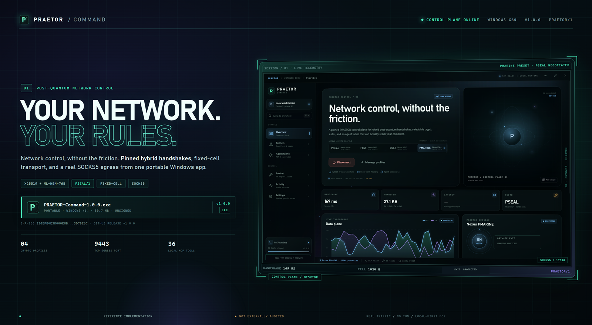
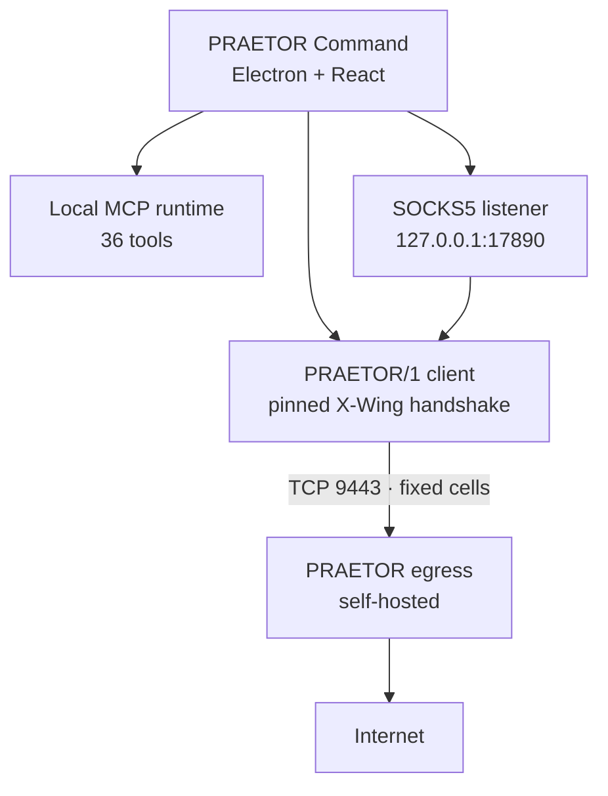
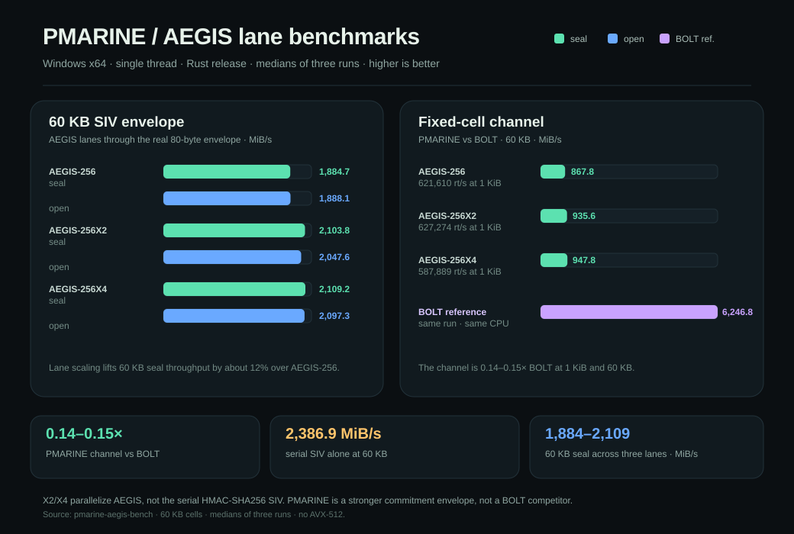

<p align="center">
  
</p>

<h1 align="center">PRAETOR / 1</h1>

<p align="center">
  <strong>Post-quantum authenticated transport and enforcement, with a real Windows control plane.</strong><br />
  <sub>Fixed-cell PRAETOR/1 · X25519 + ML-KEM-768 · PSEAL/1 · PMARINE (experimental) · local-first MCP</sub>
</p>

<p align="center">
  <a href="https://github.com/nobody71004/praetor-protocol/releases/tag/v1.0.0"><strong>DOWNLOAD PRAETOR COMMAND 1.0.0</strong></a>
  &nbsp;·&nbsp;
  <a href="desktop/README.md">DESKTOP GUIDE</a>
  &nbsp;·&nbsp;
  <a href="praetor/docs/DESIGN.md">PROTOCOL SPEC</a>
  &nbsp;·&nbsp;
  <a href="praetor/docs/BENCHMARKS.md">BENCHMARKS</a>
</p>

<p align="center">
  <code>WINDOWS x64</code>
  <code>NODE 20+</code>
  <code>RUST 1.75+</code>
  <code>PRAETOR/1</code>
  <code>GPL-3.0-or-later</code>
</p>

> [!WARNING]
> **Reference implementation. Not externally audited.**
> PRAETOR is a research-grade protocol and desktop control plane, not a certified security product. Do not protect life-critical data with it yet. PMARINE is experimental and currently Rust-only. The Windows EXE is unsigned. Read [Security posture](#security-posture) before deploying anything.

---

## What this repository is

PRAETOR is two things that share one protocol:

| Surface | What it does | Where it lives |
|---|---|---|
| **PRAETOR Command** | Windows desktop control plane: profile switching, real TCP egress, Windows system-proxy management, session telemetry, local MCP tools, and an agent fabric. | [`desktop/`](desktop/README.md) |
| **PRAETOR/1** | Fixed-cell authenticated transport with a hybrid post-quantum handshake, SIV-based record protection, capability enforcement, and cross-language test vectors. | [`praetor/`](praetor/README.md) |
| **PRAETOR Rust** | Byte-compatible Rust implementation with zero-copy channels, FAST/BOLT profiles, and the experimental PMARINE fixed-cell channel. | [`praetor-rs/`](praetor-rs/README.md) |
| **PRAETOR egress** | Self-contained exit that terminates a PRAETOR session and forwards multiplexed TCP streams. The Node and Rust implementations share one frame protocol. | [`desktop/server/`](desktop/server/README.md) · [`praetor-rs/src/egress.rs`](praetor-rs/src/egress.rs) |

The desktop app does **not** speak WireGuard. It does not create a TUN device, change IP forwarding, or install a kernel driver. It opens a pinned PRAETOR/1 TCP session, exposes a local SOCKS5 listener, and points the Windows system proxy at it while connected.

---

## Choose your path

| You want to… | Start here |
|---|---|
| **Use the app on Windows** | [Download the portable EXE](#1-use-the-windows-app) |
| **Read or audit the protocol** | [`praetor/docs/DESIGN.md`](praetor/docs/DESIGN.md) and [`THREAT-MODEL.md`](praetor/docs/THREAT-MODEL.md) |
| **Build and test the JavaScript reference** | [`praetor/README.md`](praetor/README.md) |
| **Build and test the Rust crate** | [`praetor-rs/README.md`](praetor-rs/README.md) |
| **Build the desktop app or EXE** | [`desktop/README.md`](desktop/README.md) |
| **Run your own egress server** | [Deploy your own exit](#4-deploy-your-own-egress) |
| **Connect an external agent** | [MCP and external agents](#5-connect-an-external-agent) |

---

## The system at a glance



### The data path, in order

1. The renderer selects a profile and calls the local Electron main process.
2. The main process opens a TCP connection to the profile's `endpoint`.
3. Client and server complete **PRAETOR-HS/1**: ephemeral X25519 + ML-KEM-768, transcript binding, and two-sided confirmation.
4. Application bytes are carried in fixed-size **PRAETOR/WIRE** cells with random padding and no cleartext length magic.
5. Each cell is protected by **PSEAL/1**: an SIV prefix, ChaCha20-Poly1305 ciphertext, and an independent commitment tag.
6. The local SOCKS5 listener multiplexes browser/app connections over the session as `CONNECT` / `DATA` / `CLOSE` frames.
7. While connected, Windows WinINET is pointed at `socks=127.0.0.1:<port>` with a `<local>` bypass. Disconnecting, switching profiles, or quitting restores the previous proxy values.

> **Transport boundary:** this is a TCP proxy, not a TUN/IP tunnel. Browsers and applications that honor the Windows system proxy use it. Apps with their own proxy settings, raw sockets, or their own network stack bypass it.

---

## The four crypto profiles

The desktop app ships with four seeded profiles. All four currently connect through the **PSEAL** transport because the JavaScript egress client implements PSEAL; the app explicitly reports the negotiated suite rather than pretending otherwise.

| Profile | Desktop transport | Rust channel | Status | Use it for |
|---|---|---|---|---|
| **PSEAL** | PSEAL/1 | PSEAL/1 | Default | Strongest general-purpose profile; SIV + independent commitment |
| **FAST** | PSEAL fallback | AES-256-GCM | Opt-in | Throughput-sensitive Rust workloads |
| **BOLT** | PSEAL fallback | AEGIS-128L | Opt-in | Lowest per-cell cost in the Rust crate |
| **PMARINE** | PSEAL fallback | AEGIS-256 fixed-cell channel | Experimental | Testing the PSEAL/2 envelope and Rust `PmarineChannel` |

The profile names are **routing presets** in the desktop app today. The Rust crate contains real FAST, BOLT, and PMARINE channels; they are not negotiated by the Electron client yet. The PMARINE profile is intentionally labeled experimental, and the UI shows `PSEAL` as the actual suite when it connects.

### What PSEAL gives you

- **80-byte overhead** in probabilistic mode: 16-byte nonce, 16-byte SIV prefix, 16-byte Poly1305 tag, 32-byte commitment tag.
- **64-byte deterministic mode** when an explicit nonce is supplied.
- **Nonce-misuse resistance:** the SIV is derived from the plaintext, so nonce reuse leaks equality rather than the keystream.
- **Key commitment:** an independent HMAC commitment prevents a ciphertext from verifying under two keys.
- **Fixed-cell framing:** no cleartext magic, version, suite ID, message length, or record count.

PMARINE keeps the same envelope shape but replaces the inner AEAD and separate commitment with AEGIS-256 and a 32-byte SIV used as the AEGIS nonce. It is Rust-only, experimental, and not the default. See [`praetor/docs/PMARINE.md`](praetor/docs/PMARINE.md).

---

## Benchmarks

Single process, single thread, release builds on Windows x64. These are protocol CPU costs, not VPN wall-clock numbers: no TUN, UDP, routing, or syscall path is included. Full methodology and earlier runs are in [`praetor/docs/BENCHMARKS.md`](praetor/docs/BENCHMARKS.md).

### Transport profiles


The WireGuard series is userspace `boringtun` 0.7.1, not kernel WireGuard. PSEAL pays for two-pass SIV, the independent commitment tag, 80-byte cells and the hybrid handshake; FAST and BOLT are opt-in profiles without SIV.

### PMARINE: SIV + AEGIS-256

`pmarine-aegis-bench` measures AEGIS-256, AEGIS-256X2 and AEGIS-256X4 through the real 80-byte SIV envelope and `PmarineChannel` fixed-cell channel. Results are medians of three timed runs on the same Windows x64 machine (AES/VAES/AVX2; no AVX-512).



Run it with:

```bash
cd praetor-rs
./cargo.sh run --release --bin pmarine-aegis-bench
```

<details>
<summary>Exact PMARINE measurements</summary>

#### Envelope throughput (MiB/s)

| PMARINE envelope | AEGIS-256 | AEGIS-256X2 | AEGIS-256X4 |
|---|---:|---:|---:|
| 1 KiB seal | 1,384.2 | 1,383.5 | 1,326.8 |
| 1 KiB open | 1,122.0 | 1,109.2 | 1,076.6 |
| 60 KB seal | 1,884.7 | 2,103.8 | 2,109.2 |
| 60 KB open | 1,888.1 | 2,047.6 | 2,097.3 |
| 1 MiB seal | 1,363.7 | 1,465.2 | 1,443.1 |
| 1 MiB open | 1,347.5 | 1,451.3 | 1,445.2 |

#### Fixed-cell channel

| PMARINE channel | 1 KiB roundtrips/s | 60 KB throughput | vs BOLT (1 KiB / 60 KB) |
|---|---:|---:|---:|
| AEGIS-256 | 621,610 | 867.8 MiB/s | 0.14× / 0.14× |
| AEGIS-256X2 | 627,274 | 935.6 MiB/s | 0.14× / 0.15× |
| AEGIS-256X4 | 587,889 | 947.8 MiB/s | 0.14× / 0.15× |

</details>

BOLT's fixed-cell channel measured **4,165.2 MiB/s** at 1 KiB and **6,246.8 MiB/s** at 60 KB in the same run. The serial HMAC-SHA256 SIV is now the dominant per-cell cost—the SIV alone measures 1,761.5 MiB/s at 1 KiB and 2,386.9 MiB/s at 60 KB—so X2/X4 speed up only the AEGIS portion and do not close the BOLT gap. PMARINE is the stronger commitment envelope, not a BOLT competitor.

---

## What ships in the box

| Capability | Status | Details |
|---|---|---|
| PRAETOR/1 handshake | Stable reference | X25519 + ML-KEM-768, ephemeral client keys, pinned server X-Wing key |
| PSEAL/1 | Stable reference | SIV + ChaCha20-Poly1305 + independent commitment tag |
| Fixed-cell wire transport | Stable reference | 1024 B cells → 1104 B on the wire; 4-epoch trial decryption window |
| Windows system proxy | Stable | Stable loopback port `17890`, `<local>` bypass, persistent backup and crash recovery |
| SOCKS5 / SOCKS4 egress | Stable | TCP CONNECT multiplexing; DNS resolved by the exit |
| PMARINE | Experimental | Rust `PmarineChannel`, replay window, cell-geometry AAD, zero-copy paths |
| Desktop MCP server | Stable | 36 local tools; guarded by roots, policy, and an audit chain |
| Optional model agent | Stable | Any OpenAI-compatible chat-completions endpoint; key held in memory only |
| Cross-language vectors | Stable | Shared PSEAL, KEM, Padmé, and Shamir vectors |
| Signed installer | Not available | The portable EXE is unsigned; SmartScreen may warn |

---

## 1. Use the Windows app

### Requirements

- Windows 10 or 11, x64.
- Outbound TCP to the egress endpoint configured in your profile.
- No Node installation is required to run the packaged app. Node.js 20+ is only needed for external MCP clients.

### Step 1 — Download the portable EXE

Open the [v1.0.0 release](https://github.com/nobody71004/praetor-protocol/releases/tag/v1.0.0) and download:

```text
PRAETOR-Command-1.0.0.exe
```

Or from PowerShell:

```powershell
Invoke-WebRequest `
  -Uri "https://github.com/nobody71004/praetor-protocol/releases/download/v1.0.0/PRAETOR-Command-1.0.0.exe" `
  -OutFile "PRAETOR-Command-1.0.0.exe"
```

### Step 2 — Verify the download

```powershell
Get-FileHash .\PRAETOR-Command-1.0.0.exe -Algorithm SHA256
```

Expected SHA-256:

```text
330efb4e3d000e8bcca5766b1ac7ed4eba86cf03e2730e52f4a5841563d79e6c
```

Expected size: `80,679,566` bytes.

The EXE is unsigned. If SmartScreen appears, choose **More info → Run anyway** only after verifying the hash above.

### Step 3 — Launch and connect

1. Run `PRAETOR-Command-1.0.0.exe`. It is portable; there is no installer.
2. On first launch, the app seeds four profiles: **Nexus PSEAL**, **Nexus FAST**, **Nexus BOLT**, and **Nexus PMARINE**.
3. Select **Nexus PSEAL** on the Overview page.
4. Press **Connect**.
5. Wait for the session card to show **ONLINE**. The dashboard reports the handshake time, suite, cell size, proxy port, and live traffic.
6. Verify that browser traffic is exiting through the egress:

```powershell
curl.exe --socks5-hostname 127.0.0.1:17890 https://ipinfo.io/json
```

The response should show the public address of the egress you configured. This guide does not publish a shared exit address.

If the app chose a different local port because `17890` was occupied, use the port shown in the session card.

### Step 4 — Disconnect cleanly

Press **Disconnect** before closing the app. The app restores the previous WinINET proxy settings. If the process is killed while connected, the next launch restores direct access before opening the window.

State and logs live under:

```text
%APPDATA%\PRAETOR Command\
```

The Windows proxy registry key is:

```text
HKCU\Software\Microsoft\Windows\CurrentVersion\Internet Settings
```

### What the desktop app actually does

- Client X-Wing keypairs are ephemeral per handshake and are never written to a profile.
- The server public key is pinned for every profile. It must be exactly 1,216 decoded bytes.
- The local SOCKS listener uses port `17890`; it falls back to an ephemeral port only if that port is already occupied.
- The app writes a persistent proxy backup and managed-proxy marker before changing WinINET.
- The proxy bypass is `<local>`, so loopback and local-network destinations do not go through the egress.
- Traffic counters and handshake time come from the real transport, not from synthetic UI metrics.

> [!NOTE]
> The desktop app reports `PSEAL` for all four seeded profiles today. Selecting Nexus FAST, BOLT, or PMARINE changes the requested preset and Activity label, not the negotiated channel. This is deliberate until those channels are wired into the JavaScript client.

---

## 2. Build and test from source

### Toolchain matrix

| Tool | Version | Needed for |
|---|---|---|
| Node.js | 20+ (Node 24 tested) | JavaScript reference, desktop app, MCP |
| npm | Bundled with Node | Dependency install and scripts |
| Rust | 1.75+ | Rust crate and CLI |
| C compiler | MSVC C++ Build Tools or `clang-cl` | AEGIS native build |
| Git Bash / PowerShell | Current | Commands on Windows |
| Linux + systemd + nftables | Node 22 on the host | Self-hosted egress only |

### Step 1 — Clone

```bash
git clone https://github.com/nobody71004/praetor-protocol.git
cd praetor-protocol
```

The repository is private; use an account with access.

### Step 2 — JavaScript reference

```bash
cd praetor
npm ci
npm test
npm run test:browser
```

Expected:

```text
59 tests passed
browser bundle: PASS
```

The JS package contains the reference AEAD, handshake, fixed-cell channel, container format, policy layer, CLI, browser bundle, and shared vectors.

Useful commands:

```bash
node bin/praetor.js selftest
node bin/praetor.js bench
node bin/praetor.js keygen --out demo.key
```

### Step 3 — Rust crate

```bash
cd ../praetor-rs
./cargo.sh test --release
./cargo.sh run --release -- selftest
```

Expected: **41 tests passed**, including 17 PMARINE tests and the AEGIS-256 RFC 10032 vector.

On Windows, `aegis` needs a working C compiler. If you have Visual Studio's C++ workload but not `clang-cl`, force MSVC:

```bash
# Git Bash, opened from a Visual Studio Developer Command Prompt
CC=cl ./cargo.sh test --release
```

PowerShell equivalent:

```powershell
$env:CC = "cl"
bash ./cargo.sh test --release
```

If `cargo.sh` finds the project-local `.toolchain`, it uses that; otherwise it uses the system `cargo`.

### Step 4 — Desktop development

```bash
cd ../desktop
npm ci
npm run dev
```

`npm run dev` builds the MCP bundles, starts Vite on `127.0.0.1:5173`, and launches Electron.

For production-renderer mode without packaging:

```bash
npm run build
npm start
```

### Step 5 — Build the portable EXE

```bash
cd desktop
npm ci
npm run dist
```

Output:

```text
desktop/release/PRAETOR-Command-1.0.0.exe
```

To regenerate the application icon after changing the mark:

```bash
npm run icon
npm run dist
```

If electron-builder cannot reach GitHub for its Windows toolsets, use the mirror documented in [`desktop/README.md`](desktop/README.md):

```bash
ELECTRON_BUILDER_BINARIES_MIRROR="https://npmmirror.com/mirrors/electron-builder-binaries/" \
  npx electron-builder --win portable
```

The build writes `release/` and `node_modules/` but does not commit either. The EXE is unsigned; configure a code-signing certificate before distributing it to untrusted users.

### Step 6 — Verify the package

```bash
cd desktop
node mcp/agent-pipeline.mjs
./node_modules/.bin/asar list release/win-unpacked/resources/app.asar | head
```

The packaged `app.asar` should include `dist/`, `electron/`, and `package.json`; the portable EXE is built from that unpacked application.

---

## 3. Profile reference

Each profile stores only client-side configuration:

| Field | Meaning |
|---|---|
| `protocol` | Always `PRAETOR/1` |
| `suite` | `PSEAL`, `FAST`, `BOLT`, or `PMARINE` |
| `endpoint` | TCP `host:port` for your egress |
| `cellSize` | Fixed framing size; both ends must match; default `1024` |
| `serverPublicKey` | Pinned 1,216-byte X-Wing public key (base64) |
| `autoConnect` | Connect when the app starts, if global auto-connect is enabled |

The seeded profiles pin the bundled reference key and endpoint. To use your own exit, replace both in the profile editor, or change the defaults in:

- [`desktop/src/lib/praetor.js`](desktop/src/lib/praetor.js)
- [`desktop/electron/store.cjs`](desktop/electron/store.cjs)

Changing the server key invalidates every existing profile that pins the old key. Distribute the new public key out of band; never ship the private key.

---

## 4. Deploy your own egress

This section is for a Linux host. The egress is a userspace TCP forwarder: it does not create a TUN device and does not need IP forwarding.

### Host requirements

- Linux with systemd and nftables.
- Either the Node.js 22 bundle below or the native Rust `praetor-egress` binary (no Node runtime required).
- Root access for the service and ingress rule.
- Inbound TCP `9443` allowed.

### Step 1 — Generate a server keypair

Run from the `praetor` source checkout:

```bash
cd praetor
node --input-type=module <<'NODE'
import { writeFileSync } from 'node:fs';
import { generateServerKeypair } from './src/index.js';

const { publicKey, secretKey } = generateServerKeypair();
writeFileSync('server.key', `${secretKey.toString('base64')}\n`, { mode: 0o600 });
writeFileSync('server.pub', `${publicKey.toString('base64')}\n`);
NODE
```

`server.key` is the 2,432-byte private key. **Never commit it, paste it into chat, or put it in the desktop app.** The repository ships only `desktop/server/keys/praetor-server.pub`.

Put the private key where the deploy script expects it:

```bash
cp server.key ../desktop/server/keys/praetor-server.key
cp server.pub ../desktop/server/keys/praetor-server.pub
```

Update the pinned public key in the desktop profiles, or update the defaults and rebuild the app.

### Step 2 — Build the server bundle

```bash
cd praetor
npm ci
node_modules/.bin/esbuild bin/praetor-egress.js \
  --bundle --platform=node --format=esm --target=node20 \
  --outfile=dist/praetor-egress.mjs
```

Expected output:

```text
dist/praetor-egress.mjs
```

### Step 2b — Native Rust exit (optional)

The same exit is available as a Rust binary in `praetor-rs` and speaks the same egress frames:

```bash
cd praetor-rs
./cargo.sh build --release --bin praetor-egress
./target/release/praetor-egress --key ../praetor/server.key --host 0.0.0.0 --port 9443
```

It accepts `--cell-size`, `--max-message-mib`, `--connect-timeout-ms` and `--quiet`, and prints a JSON startup line. Use the same `server.key` you generated above. This path needs no Node installation on the exit host; skip the Node bundle and run the binary under your own service manager.

### Step 3 — Deploy the service

From the repository root:

```bash
PRAETOR_EGRESS_SSH=root@your.host \
PRAETOR_EGRESS_SSH_KEY="$HOME/.ssh/id_ed25519" \
bash desktop/server/deploy.sh
```

The script:

1. Creates `/opt/praetor-egress`.
2. Copies the bundle and private key.
3. Installs `praetor-egress.service` and `praetor-ingress.service`.
4. Installs `praetor-ingress-rule.sh`.
5. Enables both units and prints the service status.

Set `PRAETOR_EGRESS_SSH` and `PRAETOR_EGRESS_SSH_KEY` explicitly for your host; no public deployment target is documented here.

The ingress helper adds:

```text
tcp dport 9443 accept comment "praetor:egress"
```

to the existing `inet nexus_edge` table. If you use a different firewall layout, adapt [`desktop/server/praetor-ingress-rule.sh`](desktop/server/praetor-ingress-rule.sh) or open TCP `9443` yourself.

### Step 4 — Verify the server

```bash
systemctl status praetor-egress
ss -lntp | grep 9443
nft list chain inet nexus_edge input | grep praetor
```

### Step 5 — Verify the exit from a client

From the repository root:

```bash
node praetor/bin/praetor-proxy.js \
  --host egress.example.com --port 9443 \
  --server-key desktop/server/keys/praetor-server.pub \
  --listen 1080
```

In another terminal:

```bash
curl --socks5-hostname 127.0.0.1:1080 https://ipinfo.io/json
```

The response must show your egress host's public address.

### Egress security notes

- The client authenticates the **server** with the pinned X-Wing key.
- The server does **not** authenticate individual clients. Anyone who has the public key and can reach TCP `9443` can use the exit.
- Keep the public key distribution private, add a network allowlist, or add a pre-shared admission check before exposing an exit to untrusted users.
- The egress supports **PSEAL only** today. FAST, BOLT, and PMARINE are Rust-side channels and are not negotiated by this server.
- Run the egress process as an unprivileged user once the nftables rule exists; the reference service unit uses root because the reference host layout does.

---

## 5. Connect an external agent

The desktop app includes a local MCP runtime with 36 tools: system information, screen capture, mouse/keyboard input, application control, filesystem access, shell, developer workflows, clipboard, notifications, processes, and policy inspection.

### In the app

1. Open **Agent Fabric**.
2. Run the built-in diagnostic.
3. Copy the generated MCP config.
4. Keep **Full control** disabled unless you specifically need destructive or system-wide actions.

The generated config is written to:

```text
%APPDATA%\PRAETOR Command\mcp-config.json
```

The bundled MCP runtime lives in:

```text
%APPDATA%\PRAETOR Command\mcp\
```

### External client example

Install Node.js 20+ so the config remains valid after the app closes, then point your MCP client at the generated server:

```json
{
  "mcpServers": {
    "praetor-computer-use": {
      "command": "C:\\Program Files\\nodejs\\node.exe",
      "args": ["C:\\Users\\<you>\\AppData\\Roaming\\PRAETOR Command\\mcp\\server.mjs"],
      "env": {
        "PRAETOR_MCP_ROOTS": "C:\\Users\\<you>",
        "PRAETOR_MCP_AUDIT": "C:\\Users\\<you>\\AppData\\Roaming\\PRAETOR Command\\audit.jsonl",
        "PRAETOR_MCP_ALLOW_WRITES": "1",
        "PRAETOR_MCP_ALLOW_SHELL": "0",
        "PRAETOR_MCP_ALLOW_FULL": "0"
      }
    }
  }
}
```

Run the diagnostic from a terminal:

```bash
cd desktop
npm run mcp:test
```

### MCP safety model

- Filesystem roots are allowlisted; tools cannot escape them.
- Shell and full-control tools stay disabled unless explicitly enabled in Settings or Agent Fabric.
- Every tool invocation is appended to `%APPDATA%\PRAETOR Command\audit.jsonl`.
- Agent API keys are held in memory for the run only and passed to the child through its environment.
- The renderer has no Node integration; it uses a narrow, context-isolated preload bridge.
- External links are opened only after an HTTP(S) check.

---

## Verification matrix

Last verified: **2026-11-09**, Windows x64, release build.

| Check | Result |
|---|---|
| JavaScript protocol suite | **59 / 59 passed** |
| Rust protocol suite | **41 / 41 passed** |
| PMARINE tests | **17 passed**, including RFC 10032 vector |
| Renderer production build | Passed |
| Packaged `app.asar` profile seed | Four profiles, schema 4 |
| Schema-3 → schema-4 migration | PMARINE injected and persisted once |
| Portable EXE packaged | `PRAETOR-Command-1.0.0.exe`, 80,679,566 bytes |
| Release asset digest | `sha256:330efb4e3d000e8bcca5766b1ac7ed4eba86cf03e2730e52f4a5841563d79e6c` |
| Real TCP egress | PSEAL handshake and SOCKS5 traffic verified against a self-hosted test exit |

The protocol tests cover roundtrips, tamper rejection, replay rejection, padding, key separation, handshake impersonation, KEM implicit rejection, guard policy, audit-chain tampering, Shamir custody, proof-of-work admission, and the PMARINE channel geometry.

---

## Security posture

**PRAETOR is not a drop-in replacement for TLS on the public web.** It has no PKI, OCSP, or ALPN. The reference server key is pinned; distribution is a trust decision you must make.

- **Not externally audited.** The construction is argued by reduction to named primitives, not by a completed public cryptanalysis program.
- **PMARINE is experimental.** The Rust `PmarineChannel` exists, but the Electron client does not negotiate it.
- **The JS implementation is not constant-time.** JIT and library behavior are not a hardened side-channel boundary.
- **No FIPS 140-3 certification, no CNSA 2.0 compliance.** Those require a validated module boundary, different parameter choices, and certification work.
- **No client authentication on the reference egress.** The public key identifies the server, not the user.
- **The EXE is unsigned.** Verify the SHA-256 before running it.
- **The system proxy is not a TUN.** Apps with their own network stack can bypass it.
- **Do not commit private keys.** The repository contains a public key only; treat `server.key` and `praetor-server.key` as secrets.

Read [`praetor/docs/SECURITY.md`](praetor/docs/SECURITY.md), [`THREAT-MODEL.md`](praetor/docs/THREAT-MODEL.md), and [`SECURITY-REVIEW.md`](praetor/docs/SECURITY-REVIEW.md) before making deployment decisions.

---

## Repository map

```text
praetor/                  JavaScript reference, CLI, browser bundle, tests, vectors
praetor-rs/               Rust implementation, zero-copy channels, PMARINE
praetor/docs/             protocol design, threat model, benchmarks, security review
desktop/                  Electron + React control plane
desktop/electron/         main process, preload bridge, local store, PRAETOR client
desktop/mcp/              policy, 36 tools, stdio server, agent pipeline
desktop/server/           self-hosted egress bundle, systemd units, ingress helper
desktop/release/          generated portable EXE (ignored by Git)
docs/                     README hero and visual assets
```

### Documentation index

| Document | Read it for |
|---|---|
| [`praetor/docs/DESIGN.md`](praetor/docs/DESIGN.md) | Byte-level protocol and wire format |
| [`praetor/docs/TRANSPORT.md`](praetor/docs/TRANSPORT.md) | TCP framing, backpressure, cell handling |
| [`praetor/docs/THREAT-MODEL.md`](praetor/docs/THREAT-MODEL.md) | Adversaries, rogue agents, mass coordination |
| [`praetor/docs/PMARINE.md`](praetor/docs/PMARINE.md) | PSEAL/2 envelope and fixed-cell channel |
| [`praetor/docs/FAST.md`](praetor/docs/FAST.md) | AES-256-GCM profile |
| [`praetor/docs/BOLT.md`](praetor/docs/BOLT.md) | AEGIS-128L profile |
| [`praetor/docs/BENCHMARKS.md`](praetor/docs/BENCHMARKS.md) | Throughput and handshake methodology |
| [`praetor/docs/SECURITY.md`](praetor/docs/SECURITY.md) | Guarantees, non-goals, certification path |
| [`praetor/docs/SECURITY-REVIEW.md`](praetor/docs/SECURITY-REVIEW.md) | Findings and fixes |
| [`desktop/README.md`](desktop/README.md) | Desktop build, proxy lifecycle, MCP details |
| [`desktop/server/README.md`](desktop/server/README.md) | Egress deployment and server notes |

---

## License

GNU General Public License v3.0 or later (GPL-3.0-or-later). See [LICENSE](LICENSE) for the full text. Third-party dependencies retain their own licenses.

<br />

<p align="center">
  <sub>PRAETOR / 1 · control the path, not just the packet · built for the machine-speed adversary</sub>
</p>
