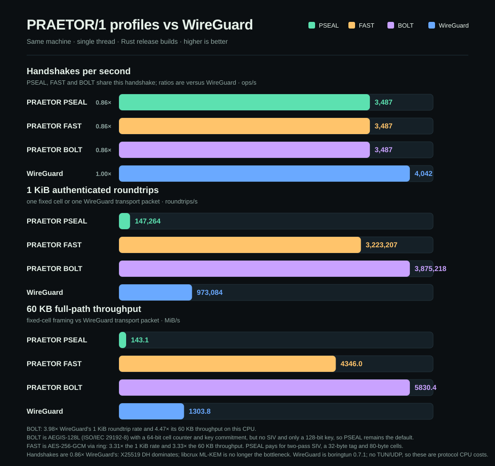

# PRAETOR/1

**A post-quantum authenticated transport and enforcement protocol, built for a
world where the adversary is automated, post-quantum, and already recording.**

PRAETOR/1 introduces **PSEAL/1**, a new SIV + independent-commitment AEAD
construction, and wraps it in fixed-cell transport, hybrid post-quantum key
establishment, forward secrecy, and a capability layer designed to survive a
rogue AI agent or a coordinated botnet. PSEAL is new at the construction level;
it composes standard, analysed primitives rather than inventing a block cipher
or permutation.

> **Status: reference implementation, not externally audited.**
> "Military-grade" is a procurement claim, not a security property. See
> [`docs/SECURITY.md`](docs/SECURITY.md) for exactly what is and is not proven,
> and the certification path (FIPS 140-3, CNSA 2.0) required before classified
> use. Do not protect life-critical data with this yet.

---

## Why another protocol?

| Failure mode | What usually happens | What PRAETOR does |
|---|---|---|
| Nonce reuse | GCM/ChaCha20-Poly1305 catastrophically leak the keystream | **SIV construction**: the AEAD nonce is derived from the plaintext, so nonce reuse leaks only equality |
| Key confusion / partition oracles | A ciphertext verifies under two keys | **Key-committing tag** over an independent commitment key |
| Harvest-now-decrypt-later | Classical ECDH only | **Hybrid X25519 + ML-KEM-768**; secure if *either* survives |
| Traffic analysis | Variable record sizes fingerprint the application | **Fixed-size cells**, no cleartext magic/version/length, random padding, optional constant-rate cover |
| Exact-length leakage | Ciphertext length equals plaintext length | **Padmé** padding: O(log log M) leakage, ≤12% overhead |
| Rogue agent / stolen capability | Bearer key decrypts everything forever | **Purpose-bound capabilities**, quotas, canaries, lockouts, audit chain, Shamir custody |
| Mass handshake floods | Server burns CPU per request | **Proof-of-work admission** that escalates under load |
| Silent history rewriting | Mutable logs | **Hash-chained audit log** verifiable after the fact |

PSEAL/1 is a new **AEAD construction**, not a new block cipher or permutation.
That distinction matters: inventing an unanalysed cipher is how systems die
(CWE-1240). PSEAL's security argument rests on SIV (Rogaway–Shrimpton),
encrypt-then-MAC, and an independent commitment key — all standard, named
components. The construction itself is new and has not had years of public
cryptanalysis. Do not treat novelty as a proof of strength.

## What is actually new

| Layer | Status |
|---|---|
| **PSEAL/1** | New AEAD construction: SIV prefix + ChaCha20-Poly1305 + independent commitment tag |
| **PRAETOR/WIRE** | Fixed-cell framing with trial decryption over a bounded epoch window |
| **PRAETOR-HS/1** | Hybrid X25519 + ML-KEM-768 handshake with two-sided confirmation |
| **PRAETOR/GUARD** | Capability, quota, audit, custody and admission enforcement |

PSEAL is the new cryptographic primitive in this project. It is not a new
low-level cipher, and this repository does not claim that it is.

## Security is not a single benchmark number

PRAETOR is designed for stronger **specific** properties than WireGuard:
post-quantum key establishment, nonce-misuse resistance, ciphertext key
commitment, and fixed-cell metadata hiding. WireGuard is much more widely
reviewed, has a smaller codebase and a mature kernel data path. Those are real
security advantages too. The honest comparison is a threat-model table, not a
claim that one word makes a system invulnerable.

## Quickstart (JavaScript reference)

```bash
cd praetor
npm install
npm test                 # 59 tests incl. tamper, replay, downgrade, policy
npm run test:browser     # browser bundle parity (handshake, cells, PSEAL, KEM)
npm run build:browser    # browser/dist + standalone browser/demo.html
node bin/praetor.js selftest
node bin/praetor.js bench

node bin/praetor.js keygen --out demo.key
printf 'hello praetor' | node bin/praetor.js seal --key demo.key --out msg.pseal --json
node bin/praetor.js open --key demo.key --in msg.pseal

node bin/praetor.js encrypt --key demo.key --in big.bin --out big.praetor --pad 1048576
node bin/praetor.js decrypt --key demo.key --in big.praetor --out big.out
```

Rust implementation:

```bash
cd praetor-rs
./cargo.sh test           # 14 tests, byte-compatible with the JS vectors
./cargo.sh run --release -- selftest
./cargo.sh run --release -- bench
```

## Architecture

```
 application message
        │
        ▼
┌───────────────────────┐   fragmentation, ids, random padding
│  PRAETOR/WIRE cells     │   fixed 1024 B plaintext → 1104 B on the wire
│  (no magic, no len)   │   trial-decryption over a 4-epoch window
└──────────┬────────────┘
           │ per-epoch key (ratcheted every 1024 records)
           ▼
┌───────────────────────┐   prefix = HMAC(pt, nonce) → SIV
│  PSEAL/1 envelope     │   ct = ChaCha20-Poly1305(prefix)
│  (misuse-resistant)   │   tag = HMAC(k_com, ct) → commitment
└──────────┬────────────┘
           │ keys from handshake ratchet
           ▼
┌───────────────────────┐   X25519 + ML-KEM-768, two-sided ephemeral
│  PRAETOR-HS/1 handshake │   confirmation both ways, transcript-bound
└──────────┬────────────┘
           │
           ▼
┌───────────────────────┐   purpose binding, quotas, canaries, lockouts,
│  PRAETOR/GUARD          │   circuit breaker, audit chain, Shamir 3-of-5,
│  (untrusted callers)  │   proof-of-work admission
└───────────────────────┘
```

## Transports and clients

* **TCP streaming adapter** (`@praetor/protocol/transport`): framed hybrid
  handshake, then fixed-size authenticated cells with backpressure. The server
  key must be pinned; both sides must configure the same `cellSize`. See
  [`docs/TRANSPORT.md`](docs/TRANSPORT.md).
* **Browser client** (`browser/`): an esbuild bundle of the same core code with
  WebCrypto randomness and pure-JS Noble primitives. `browser/demo.html` runs a
  complete handshake and channel self-test in the page; `npm run test:browser`
  checks bundle parity in Node. See [`docs/BROWSER.md`](docs/BROWSER.md).

Measured on one Windows x64 machine, single-threaded: the JS reference seals
1 MiB at 358 MiB/s and completes 86 handshakes/s; the Rust release build seals
at 499 MiB/s and completes 2,611 handshakes/s. See
[`docs/BENCHMARKS.md`](docs/BENCHMARKS.md) for the full tables.

There are three transport profiles. **PSEAL** is the default and is **not**
faster than WireGuard: 0.15× the 1 KiB roundtrip rate and 0.11× the 60 KB
throughput, the measured cost of two-pass SIV, the commitment tag, 80-byte
cells and ML-KEM-768. **PRAETOR/FAST** (AES-256-GCM via `ring`) reaches
**3.31×** and **3.33×**. **PRAETOR/BOLT** (AEGIS-128L) is the fastest:
**3.98×** the 1 KiB roundtrip rate and **4.47×** the 60 KB throughput, which
is 1.20× and 1.34× ahead of FAST under the same zero-copy API. The handshake
is still **0.60×**, because X25519 + ML-KEM-768 costs more than X25519 alone.
FAST and BOLT are weaker than PSEAL by design; see
[`docs/FAST.md`](docs/FAST.md) and [`docs/BOLT.md`](docs/BOLT.md).



Against Cloudflare `boringtun` 0.7.1 (userspace WireGuard, same CPU, single
thread), medians of three runs in one session: **2,611 handshakes/s** vs
**4,317**; PSEAL **147k 1 KiB roundtrips/s** and **143.1 MiB/s** at 60 KB;
FAST **3.22M** and **4,346.0 MiB/s**; BOLT **3.88M** and **5,830.4 MiB/s**,
versus WireGuard's **973k** and **1,303.8 MiB/s**. All three PRAETOR transport
rows use the same zero-copy buffer API as boringtun, so the gap is protocol
overhead and AEAD choice, not a harness difference. This is protocol CPU cost,
not a kernel-tunnel wall-clock test. Full methodology:
[`docs/BENCHMARKS.md`](docs/BENCHMARKS.md).

Full byte-level specification: [`docs/DESIGN.md`](docs/DESIGN.md).
Adversary analysis incl. rogue agents and mass coordination:
[`docs/THREAT-MODEL.md`](docs/THREAT-MODEL.md).
Literature and rationale: [`docs/RESEARCH.md`](docs/RESEARCH.md).
Measured performance: [`docs/BENCHMARKS.md`](docs/BENCHMARKS.md).
Adversarial review, findings and fixes:
[`docs/SECURITY-REVIEW.md`](docs/SECURITY-REVIEW.md).

## Byte-level guarantees

* **PSEAL overhead:** 80 bytes (16 nonce + 16 SIV prefix + 16 Poly1305 tag +
  32 commitment tag). Deterministic mode: 64 bytes.
* **Cell overhead:** 80 bytes; 1024-byte cell → 1104 bytes on the wire.
* **No cleartext structure:** no magic, version, suite id, message length or
  record count is visible. A wrong key sees random bytes.
* **Fail closed:** tag → decrypt → prefix re-derivation; no unauthenticated
  plaintext is ever released.
* **Replay/reorder/truncation/splice:** detected by message ids, fragment
  indices, per-chunk AAD and a final-chunk flag.

## Non-goals

* Not a replacement for TLS on the public web; no PKI, OCSP, or ALPN.
* Not formally verified; the security argument is by reduction to named
  primitives, not machine-checked.
* Not FIPS 140-3 validated, not CNSA 2.0 compliant (that requires ML-KEM-1024,
  AES-256/SHA-384 and a validated module boundary).
* The JS implementation is not constant-time (JIT). Use the Rust build where
  local side channels are in scope.

## Layout

```
praetor/            JavaScript reference implementation, CLI, tests, vectors
praetor-rs/         Rust implementation (byte-compatible), CLI, tests
praetor/docs/       design, threat model, research, security, AI integration
praetor/vectors/    shared cross-language test vectors
```

## Licence

MIT.
