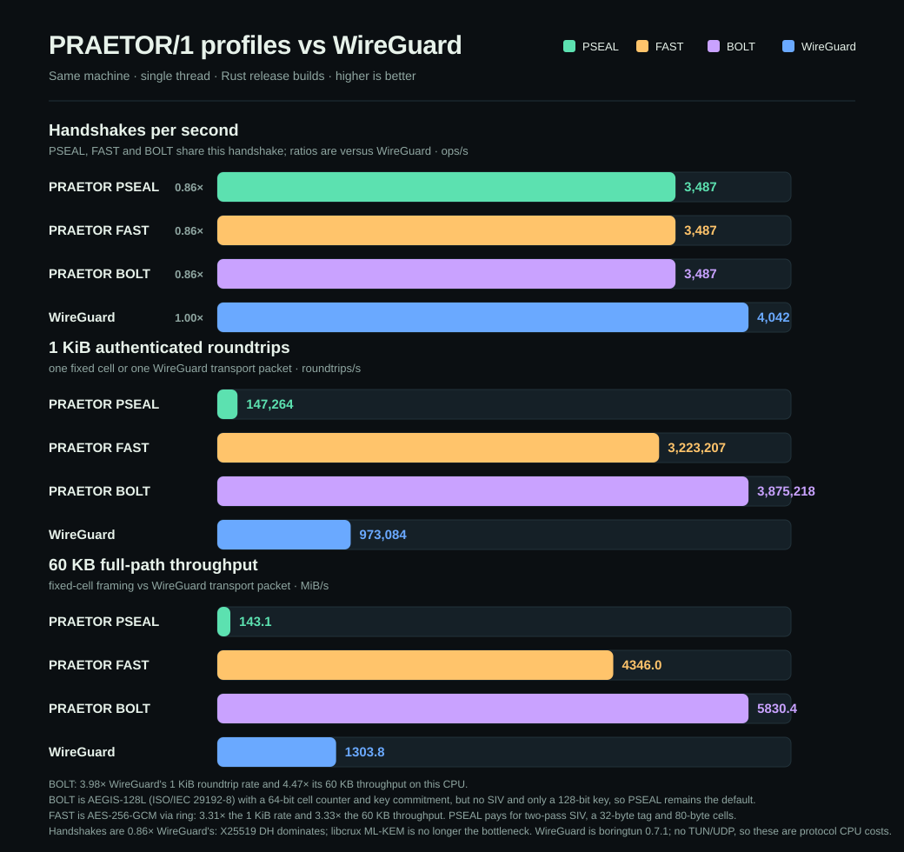

# PRAETOR/1 benchmarks

Single process, single thread, no pipelining. These are reference numbers, not
a claim about any particular deployment. Run `npm run bench` (JS) or
`./cargo.sh run --release --bin protocol-bench` (Rust, prints JSON) on your own
hardware.

## JavaScript reference — Node v24.16.0, Windows x64

| operation | bytes | MiB/s | ops/s | µs/op |
|---|---:|---:|---:|---:|
| pseal.seal | 64 | 3.6 | 58,226 | 17.2 |
| pseal.open | 64 | 4.7 | 76,259 | 13.1 |
| pseal.seal | 1,024 | 57.5 | 58,868 | 17.0 |
| pseal.open | 1,024 | 67.5 | 69,163 | 14.5 |
| pseal.seal | 65,536 | 277.2 | 4,435 | 225.5 |
| pseal.open | 65,536 | 397.4 | 6,358 | 157.3 |
| pseal.seal | 1,048,576 | 357.8 | 358 | 2,794.6 |
| pseal.open | 1,048,576 | 444.2 | 444 | 2,251.2 |
| wire.cell.roundtrip | 1,008 | 21.1 | 21,899 | 45.7 |
| kem.xwing.encap+decap | — | — | 218 | 4,583.8 |
| handshake.full | — | — | 86 | 11,583.5 |

`wire.cell.roundtrip` includes fragmentation, per-cell sealing, authentication
and reassembly end to end. `pseal` includes two passes (SIV prefix + AEAD) and
80 bytes of overhead.

## Rust release — rustc 1.99.1, Windows x64 (MSVC)

| operation | bytes | MiB/s | ops/s |
|---|---:|---:|---:|
| pseal.seal | 1,024 | 324.9 | 332,700 |
| pseal.open | 1,024 | 316.3 | 323,900 |
| pseal.seal | 60,000 | 495.5 | 8,661 |
| pseal.open | 60,000 | 655.8 | 11,462 |
| pseal.seal | 1,048,576 | 498.9 | 499 |
| pseal.open | 1,048,576 | 570.8 | 571 |
| kem.decaps | — | — | 10,364 |
| handshake.full | — | — | 2,611 |

Derived ops/s for sub-megabyte rows are computed from the measured MiB/s; the
1 MiB and handshake rows are direct iteration counts. The handshake figure
includes two X-Wing key generations, two encapsulations, two decapsulations,
transcript hashing and both confirmations. Rows below 1 MiB come from the same
three-run `protocol-bench` session as the WireGuard comparison below.

## What the numbers mean

* Bulk AEAD throughput is comparable between the two builds (both bind optimized
  ChaCha20 implementations); the Rust build's advantage is in key establishment:
  **~30× the handshake rate** and **~48× the decapsulation rate** of the JS
  reference, without JIT variance.
* At 1 MiB, sealing is CPU-bound rather than allocation-bound in both builds.
  The 64-byte JS rows are dominated by fixed per-envelope cost, which is why
  throughput is low while ops/s stays high.
* The fixed-cell path is deliberately more expensive than raw AEAD: a 1,008-byte
  message becomes a 1,104-byte cell and pays trial decryption over the epoch
  window. That cost buys headerless framing, replay resistance and length hiding.

## Cross-language validation

`praetor-rs/tests/vectors.rs` decapsulates a ciphertext produced by the JS
`@noble/post-quantum` implementation and checks AEAD, Padmé and Shamir vectors
byte for byte. The CLI roundtrip test encrypts a padded container with JS and
decrypts it with Rust, then the reverse, comparing the recovered bytes.

## PRAETOR vs WireGuard (same machine)



| Metric | PSEAL (default) | FAST | BOLT | WireGuard (boringtun 0.7.1) | PSEAL / WG | FAST / WG | BOLT / WG |
|---|---:|---:|---:|---:|---:|---:|---:|
| Full handshakes/s | 2,611 | 2,611 | 2,611 | 4,317 | 0.60× | 0.60× | 0.60× |
| 1 KiB authenticated roundtrips/s | 147,264 | 3,223,207 | 3,875,218 | 973,084 | 0.15× | 3.31× | **3.98×** |
| 60 KB full-path throughput | 143.1 MiB/s | 4,346.0 MiB/s | 5,830.4 MiB/s | 1,303.8 MiB/s | 0.11× | 3.33× | **4.47×** |
| 60 KB PSEAL seal+open (no cell framing) | 282.2 MiB/s | — | — | — | — | — | — |
| 1 MiB PSEAL seal+open (no cell framing) | 265.8 MiB/s | — | — | — | — | — | — |

Both builds are Rust release with LTO, measured on the same Windows x64
machine, single thread. Values are the median of three runs in one session;
run-to-run CPU frequency variation on this machine is large enough that only
same-session ratios should be compared. `boringtun` performs the real NoiseIK
handshake and transport encryption in process. It is **not** kernel WireGuard
and there is no TUN, UDP, routing or syscall path in either number: these are
protocol CPU costs, not VPN wall-clock. Raw data and the harness live in
[`../bench/`](../bench/); the chart is generated by
[`../bench/chart-vs-wireguard.mjs`](../bench/chart-vs-wireguard.mjs).

All three PRAETOR transport rows use the same zero-copy buffer API as
boringtun: seal into a reused buffer, then borrow the plaintext back out of it.
FAST and BOLT also expose an owned-payload API; its cost is reported in
[`BOLT.md`](BOLT.md).

PSEAL is doing more work by design: the two-pass SIV/commitment envelope, an
80-byte fixed cell, a 32-byte commitment tag, and an X25519 + ML-KEM-768
handshake. WireGuard has a classical X25519 NoiseIK handshake and no
post-quantum component or ciphertext commitment. That gap is the cost of those
properties, not an implementation accident.

### Why WireGuard was ahead, and what changed

The first FAST build lost to WireGuard (0.72× at 1 KiB, 0.60× at 60 KB) despite
using AES-256-GCM. Profiling isolated the cause: the RustCrypto `aes-gcm` 0.10
build ran GHASH on a portable path and topped out near 700 MiB/s, while
`boringtun` links `ring`, whose AES-NI/CLMUL assembly runs the same cipher at
roughly 3.3 GiB/s on this CPU. The protocol was not the bottleneck; the crypto
backend was.

FAST now links `ring`'s AES-256-GCM — the same backend boringtun uses — with an
unchanged wire format (12-byte nonce, 16-byte tag, 28-byte cell overhead,
in-place decrypt). No primitive or framing changed.

| FAST build | 1 KiB roundtrips/s | 60 KB MiB/s |
|---|---:|---:|
| RustCrypto `aes-gcm`, owned API | 619,798 | 659.1 |
| `ring` AES-256-GCM, owned API | 2,412,138 | 4,029.9 |
| `ring` AES-256-GCM, zero-copy API | 3,223,207 | 4,346.0 |

### Why BOLT is faster still

AEGIS-128L keeps eight 128-bit state blocks and absorbs 32 bytes per step with
eight independent AES rounds. That exposes eight parallel AES dependency
chains, while GCM's counter mode needs one AES round per 16-byte block with
only a handful of blocks in flight, plus CLMUL GHASH. On AES-NI hardware the
same AES unit therefore delivers several times the throughput.

BOLT's full path — cell pack, AEGIS encryption, tag check and parse — reaches
5,830.4 MiB/s at 60 KB. FAST under the same zero-copy convention reaches
4,346.0 MiB/s. BOLT is 1.20× FAST at 1 KiB and 1.34× at 60 KB.

The remaining differences are protocol-level:

* A fixed cell is one AEAD pass over a pre-sized buffer plus a 16-byte header,
  with no IP header parse, route lookup or per-packet session transition.
* The handshake gap does not close. X25519 + ML-KEM-768 costs about 1.7×
  X25519 alone, and all PRAETOR profiles pay it.
* AES acceleration is required for the transport win. Without AES-NI, AEGIS
  falls back to software AES and can be slower than PSEAL.

FAST and BOLT are weaker than PSEAL. FAST has no SIV, no key commitment and a
32-bit counter that caps a key at 2^32 cells. BOLT has no SIV and a 128-bit key,
but is key-committing and uses a 64-bit counter. See [`FAST.md`](FAST.md) and
[`BOLT.md`](BOLT.md) for the full tradeoffs.

## Reproduce

```bash
cd praetor-rs
./cargo.sh test --release
./cargo.sh run --release --bin protocol-bench
```

On Windows MSVC, BOLT's libaegis backend needs a C compiler: run from a
Developer Command Prompt, or set `CC=cl` with the MSVC `INCLUDE`/`LIB`
environment. The WireGuard side is `_wg-bench` (`boringtun` 0.7.1).
