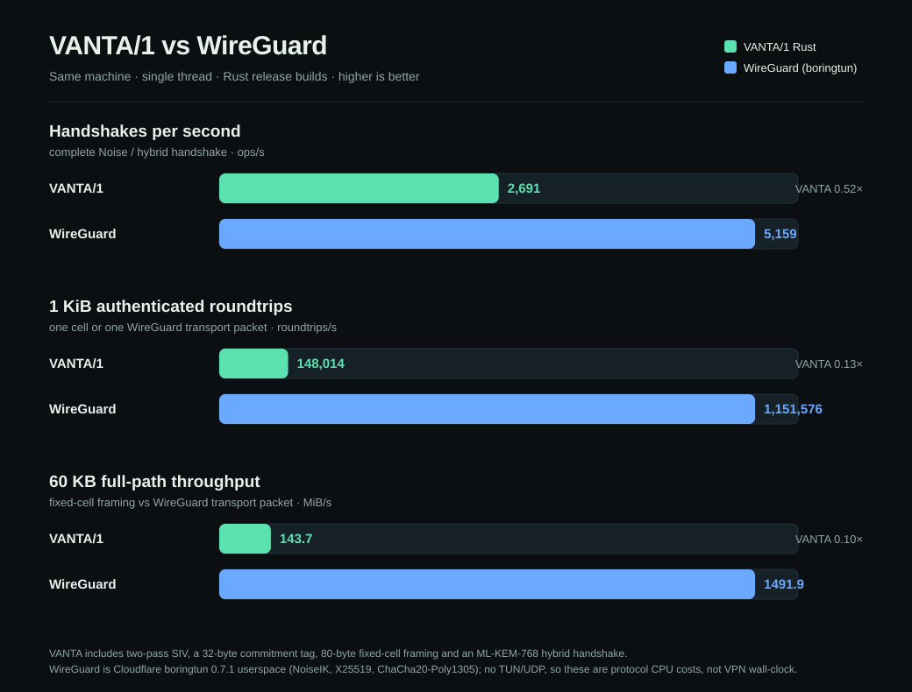

# VANTA/1 benchmarks

Single process, single thread, no pipelining. These are reference numbers, not
a claim about any particular deployment. Run `npm run bench` (JS) or
`./cargo.sh run --release -- bench` (Rust) on your own hardware.

## JavaScript reference — Node v24.16.0, Windows x64

| operation | bytes | MiB/s | ops/s | µs/op |
|---|---:|---:|---:|---:|
| vseal.seal | 64 | 3.6 | 58,226 | 17.2 |
| vseal.open | 64 | 4.7 | 76,259 | 13.1 |
| vseal.seal | 1,024 | 57.5 | 58,868 | 17.0 |
| vseal.open | 1,024 | 67.5 | 69,163 | 14.5 |
| vseal.seal | 65,536 | 277.2 | 4,435 | 225.5 |
| vseal.open | 65,536 | 397.4 | 6,358 | 157.3 |
| vseal.seal | 1,048,576 | 357.8 | 358 | 2,794.6 |
| vseal.open | 1,048,576 | 444.2 | 444 | 2,251.2 |
| wire.cell.roundtrip | 1,008 | 21.1 | 21,899 | 45.7 |
| kem.xwing.encap+decap | — | — | 218 | 4,583.8 |
| handshake.full | — | — | 86 | 11,583.5 |

`wire.cell.roundtrip` includes fragmentation, per-cell sealing, authentication
and reassembly end to end. `vseal` includes two passes (SIV prefix + AEAD) and
80 bytes of overhead.

## Rust release — rustc 1.99.1, Windows x64 (MSVC)

| operation | bytes | MiB/s | ops/s |
|---|---:|---:|---:|
| vseal.seal | 1,024 | 312.2 | 319,700 |
| vseal.open | 1,024 | 287.3 | 294,200 |
| vseal.seal | 65,536 | 382.5 | 6,120 |
| vseal.open | 65,536 | 506.4 | 8,100 |
| vseal.seal | 1,048,576 | 423.5 | 423 |
| vseal.open | 1,048,576 | 464.2 | 464 |
| kem.decaps | — | — | 10,364 |
| handshake.full | — | — | 2,116 |

Derived ops/s for sub-megabyte rows are computed from the measured MiB/s; the
1 MiB and handshake rows are direct iteration counts. The handshake figure
includes two X-Wing key generations, two encapsulations, two decapsulations,
transcript hashing and both confirmations.

## What the numbers mean

* Bulk AEAD throughput is comparable between the two builds (both bind optimized
  ChaCha20 implementations); the Rust build's advantage is in key establishment:
  **~24× the handshake rate** and **~48× the decapsulation rate** of the JS
  reference, without JIT variance.
* At 1 MiB, sealing is CPU-bound rather than allocation-bound in both builds.
  The 64-byte JS rows are dominated by fixed per-envelope cost, which is why
  throughput is low while ops/s stays high.
* The fixed-cell path is deliberately more expensive than raw AEAD: a 1,008-byte
  message becomes a 1,104-byte cell and pays trial decryption over the epoch
  window. That cost buys headerless framing, replay resistance and length hiding.

## Cross-language validation

`vanta-rs/tests/vectors.rs` decapsulates a ciphertext produced by the JS
`@noble/post-quantum` implementation and checks AEAD, Padmé and Shamir vectors
byte for byte. The CLI roundtrip test encrypts a padded container with JS and
decrypts it with Rust, then the reverse, comparing the recovered bytes.

## VANTA vs WireGuard (same machine)

| Metric | VANTA/1 Rust | WireGuard (boringtun 0.7.1) | VANTA / WG |
|---|---:|---:|---:|
| Full handshakes/s | 2,691 | 5,159 | 0.52× |
| 1 KiB authenticated roundtrips/s | 148,014 | 1,151,576 | 0.13× |
| 60 KB full-path throughput | 143.7 MiB/s | 1,491.9 MiB/s | 0.096× |
| 60 KB VSEAL seal+open (no cell framing) | 296.9 MiB/s | — | — |
| 1 MiB VSEAL seal+open (no cell framing) | 279.4 MiB/s | — | — |

Both builds are Rust release with LTO, measured on the same Windows x64
machine, single thread. `boringtun` performs the real NoiseIK handshake and
transport encryption in process. It is **not** kernel WireGuard and there is
no TUN, UDP, routing or syscall path in either number: these are protocol CPU
costs, not VPN wall-clock. Raw data and the harness live in
[`../bench/`](../bench/); the chart is generated by
[`../bench/chart-vs-wireguard.mjs`](../bench/chart-vs-wireguard.mjs).

VANTA is doing more work by design: the two-pass SIV/commitment envelope, an
80-byte fixed cell, a 32-byte commitment tag, and an X25519 + ML-KEM-768
handshake. WireGuard has a classical X25519 NoiseIK handshake and no
post-quantum component or ciphertext commitment. The gap is the cost of those
properties, not an implementation accident.
